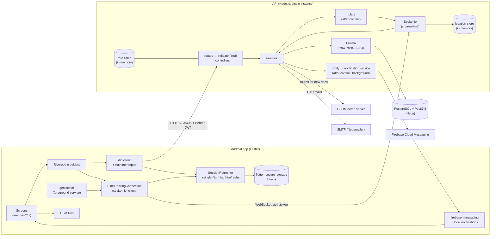

# CampusPool

Real-time ride pooling for verified college students and staff. Drivers offer rides, riders
search and request seats, and riders follow the driver live on a map once the ride starts.

| Part | Stack | Details |
| --- | --- | --- |
| [backend/](backend/) | Node.js 20, Express 4, Prisma 6, PostgreSQL + PostGIS (Neon), Socket.io, firebase-admin | [backend/README.md](backend/README.md) |
| [mobile/](mobile/) | Flutter (Android only), Riverpod, dio, go_router, flutter_map + OpenStreetMap, FCM | [mobile/README.md](mobile/README.md) |

Only free services: OpenStreetMap tiles, the public OSRM demo server for routes, any SMTP
provider for email codes, and Firebase Cloud Messaging for push.

## Architecture



- REST requests go `routes → validate → controller (asyncHandler) → service → Prisma`. Every
  error leaves through one handler as `{ "error": { "code", "message" } }`.
- Socket events and push notifications fire only after the database transaction commits, and
  never fail the request.
- Live locations and rate-limit counters live in the API process's memory, so the API must run
  as **one instance** until they move to Redis.
- Coordinates are `(lng, lat)` in PostGIS and `(lat, lng)` in Flutter; the API takes and
  returns `{ lat, lng }` objects.

## Setup

### Prerequisites

- Node.js 20+
- Docker Desktop (for the backend tests only)
- Flutter SDK and Android Studio (Android SDK, an emulator or a phone with USB debugging)
- A Neon project with PostGIS (or any PostgreSQL 16+ with PostGIS 3)
- An SMTP account (for signup codes) and, for push, a Firebase project

### Backend

```sh
cd backend
npm install
cp .env.example .env       # fill in the variables below
npm run migrate:deploy     # apply migrations to the dev database
npm run seed:dev -- --demo <password>   # optional: verified demo driver and rider + a ride
npm run dev                # http://localhost:3000, check with GET /health
```

### Mobile

```sh
cd mobile
# put your Firebase android/app/google-services.json in place first (see mobile/README.md)
flutter pub get
flutter run                                                     # emulator → http://10.0.2.2:3000
flutter run --dart-define=API_BASE_URL=http://<laptop LAN IP>:3000   # a real phone on the same Wi-Fi
```

A phone needs the laptop's port 3000 reachable: allow Node.js through the Windows firewall on
private networks.

## Environment variables

### Backend (`backend/.env`, template in [backend/.env.example](backend/.env.example))

| Variable | Required | Default | Purpose |
| --- | --- | --- | --- |
| `NODE_ENV` | no | `development` | `development`, `test` or `production` (`npm start` sets production) |
| `PORT` | no | `3000` | HTTP and Socket.io port |
| `DATABASE_URL` | **yes** | | PostgreSQL + PostGIS connection string (Neon) |
| `JWT_ACCESS_SECRET` | **yes** | | Signs access tokens and hashes OTP codes; at least 32 characters |
| `ALLOWED_EMAIL_DOMAIN` | **yes** | | Only `@<domain>` emails can sign up. The example uses `nsut.ac.in`, the app's default; another domain needs the same `--dart-define` in the app |
| `SMTP_HOST` | **yes** | | SMTP server for OTP emails |
| `SMTP_PORT` | no | `587` | `465` switches to implicit TLS |
| `SMTP_USER`, `SMTP_PASS` | no | | SMTP credentials |
| `MAIL_FROM` | no | `CampusPool <no-reply@campuspool.local>` | Sender of OTP emails |
| `CORS_ORIGIN` | in production | `*` outside production | Comma-separated exact origins; `*` refused in production |
| `ROUTING_BASE_URL` | no | `https://router.project-osrm.org` | OSRM server for ride routes |
| `FIREBASE_SERVICE_ACCOUNT_PATH` | no | | Absolute path to the Firebase service account JSON, **outside the repo**. Unset: pushes are skipped |

Test-only (`backend/.env.test`, template in [backend/.env.test.example](backend/.env.test.example)):

| Variable | Purpose |
| --- | --- |
| `TEST_DATABASE_URL` | Required under `NODE_ENV=test`; the local Docker database by default |
| `ALLOW_REMOTE_TEST_DB` | Set to `1` to allow a non-local test database (the Neon test branch) |
| `RATE_LIMIT_IN_TESTS` | Set to `1` to turn rate limits on in tests (used by `tests/rateLimits.test.js`) |

### Mobile (`--dart-define`)

| Name | Default | Rules |
| --- | --- | --- |
| `APP_ENV` | `dev` | `dev` or `prod` |
| `API_BASE_URL` | `http://10.0.2.2:3000` in debug builds only | Required in release builds and with `APP_ENV=prod`; `prod` needs `https://` |
| `ALLOWED_EMAIL_DOMAIN` | `nsut.ac.in` | Must match the backend's `ALLOWED_EMAIL_DOMAIN` |

Files that are never committed: `backend/.env`, `backend/.env.test`,
`mobile/android/app/google-services.json`, `mobile/android/key.properties`, the release keystore
and the Firebase service account JSON.

## Running tests

Backend (Jest + Supertest against a throwaway PostgreSQL 18 + PostGIS 3.6 in Docker, port 5433):

```sh
cd backend
cp .env.test.example .env.test   # once
npm run db:test:up
npm test                         # applies migrations, then runs the suite
npm run lint
npm run db:test:down
```

Tests refuse to run against the dev database, or any remote database without
`ALLOW_REMOTE_TEST_DB=1`. See [backend/README.md](backend/README.md#tests) for the Neon test branch.

Mobile:

```sh
cd mobile
flutter analyze
flutter test        # includes test/small_screens_test.dart (320 x 568 dp at 1.3x text)
```

The manual two-phone test is in [docs/manual-e2e-test.md](docs/manual-e2e-test.md).

## API

All routes take and return JSON. "Auth" means `Authorization: Bearer <access token>`. Every
route validates its params, query and body with zod; a part a route doesn't declare must be
empty, so unexpected fields get `400 VALIDATION_ERROR`.

| Method | Path | Auth | Who | Input validated |
| --- | --- | --- | --- | --- |
| GET | `/health` | no | anyone | none accepted |
| POST | `/auth/signup` | no | anyone | body: name, email (allowed domain), password (8-72, letter + digit) |
| POST | `/auth/verify-otp` | no | anyone | body: email, 6-digit code |
| POST | `/auth/resend-otp` | no | anyone | body: email |
| POST | `/auth/login` | no | anyone | body: email, password |
| POST | `/auth/refresh` | refresh token in body | anyone | body: refreshToken |
| POST | `/auth/logout` | refresh token in body | anyone | body: refreshToken |
| GET | `/users/me` | yes | any user | none accepted |
| PATCH | `/users/me` | yes | any user | body: name, phone, role (at least one) |
| PUT | `/users/me/fcm-token` | yes | any user | body: token |
| POST | `/rides` | yes | role DRIVER or BOTH | body: start, end, departureTime (15 min to 7 days ahead), seats 1-6, pricePerSeat, notes; trip over 200 m |
| GET | `/rides/mine` | yes | any user (their rides as driver) | none accepted |
| GET | `/rides/search` | yes | any user | query: pickup/drop lat and lng, from/to (at most 24 h), seats, radius 500-5000 m, limit, offset |
| GET | `/rides/:id` | yes | any user | params: id (UUID) |
| POST | `/rides/:id/cancel` | yes | the ride's driver | params: id |
| POST | `/rides/:id/start` | yes | the ride's driver | params: id |
| POST | `/rides/:id/complete` | yes | the ride's driver | params: id |
| POST | `/rides/:id/bookings` | yes | anyone but the ride's driver | params: id; body: pickup, drop, seats 1-6 |
| GET | `/rides/:id/bookings` | yes | the ride's driver | params: id |
| GET | `/bookings/mine` | yes | any user (their bookings as rider) | none accepted |
| POST | `/bookings/:id/accept` | yes | the ride's driver | params: id |
| POST | `/bookings/:id/reject` | yes | the ride's driver | params: id |
| POST | `/bookings/:id/cancel` | yes | the booking's rider | params: id |

Rate limits apply to `/auth` (see [backend/README.md](backend/README.md#production)).

Socket.io events (same server; the access token goes in the handshake's `auth.token`):

| Event | Who | Payload validated |
| --- | --- | --- |
| `ride:join` | the driver or an ACCEPTED rider | `{ rideId }` |
| `location:update` | the driver, while IN_PROGRESS, at most every 2 s | `{ rideId, lat, lng, heading?, speed? }` |
| `ride:status` (server → client) | room members | |
| `driver:location` (server → client) | room members except the driver | |

## Known gaps

Decided limits of the MVP (single instance, no pagination, no chat, fire-and-forget push, and
more) are listed in [CLAUDE.md](CLAUDE.md#known-gaps-decided-not-forgotten).
