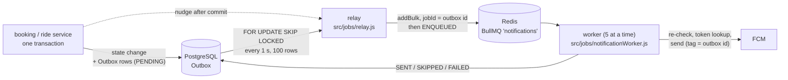

# CampusPool backend

Express + Prisma API for CampusPool. PostgreSQL + PostGIS on Neon in development and production,
and Redis (BullMQ) for the notification queue.

## Setup

Requires Node.js 20+ and Docker. **Docker Desktop must be running for `npm run dev` as well as
for the tests**: the API needs Redis, and locally that is the container `npm run db:test:up`
starts (`REDIS_URL=redis://localhost:6380/1`; the tests use db 0 of the same container).

```sh
npm install
cp .env.example .env        # fill in DATABASE_URL, JWT_ACCESS_SECRET, SMTP_*, ...
npm run migrate:deploy      # apply migrations to the dev database
npm run db:test:up          # Redis (and the test database); Docker Desktop must be running
npm run dev                 # http://localhost:3000
```

Without `REDIS_URL`, startup stops with `REDIS_URL: is required unless ENABLE_JOBS=0`. When it
is set but the container is not running, the API still serves: it logs
`[redis] ... connection lost` once, keeps retrying, and notifications wait in the outbox.
`ENABLE_JOBS=0` runs the API with no Redis at all, and nothing is sent.

## Scripts

| Script                            | What it does                                                                  |
| --------------------------------- | ----------------------------------------------------------------------------- |
| `npm run dev`                     | Start the API with nodemon                                                    |
| `npm run migrate`                 | Create and apply a new migration (`prisma migrate dev`) on the dev database   |
| `npm run migrate:deploy`          | Apply pending migrations (through `DIRECT_URL` when set, else `DATABASE_URL`) |
| `npm run db:test:up`              | Start the local test database and Redis, and wait until they are healthy      |
| `npm run db:test:down`            | Stop and remove both containers (all their data is discarded)                 |
| `npm run migrate:test`            | Apply migrations to the test database                                         |
| `npm test`                        | `migrate:test`, then the full Jest suite                                      |
| `npm run lint` / `npm run format` | ESLint / Prettier                                                             |
| `npm run seed:dev -- ...`         | Create verified dev accounts without email codes (see below)                  |
| `npm run outbox:status`           | Notification outbox: rows per status, oldest waiting row, stuck rows          |

### Dev seed

Runs only with `NODE_ENV=development` and writes to the dev database:

```sh
npm run seed:dev -- --demo <password>      # demo.driver@ (BOTH) + demo.rider@ (RIDER) + a sample ride
npm run seed:dev -- <email> <password>     # one verified RIDER
```

The demo ride is OPEN, has 3 seats and departs 2 hours after the run, near NSUT Dwarka. Its
coordinates are constants at the top of `scripts/seed-dev.js`. Re-running never changes an
existing account (it keeps its password) and adds no ride while the driver has an upcoming one.

## Push notifications

Sent through Firebase Cloud Messaging (`firebase-admin`) for seven events: booking requested,
accepted, rejected and cancelled; ride started (to accepted riders, and to riders whose pending
requests it rejected) and ride cancelled. The app registers its device token with
`PUT /users/me/fcm-token`; logout clears it.

### Delivery: transactional outbox, relay, worker



1. **Outbox.** The service inserts one `Outbox` row **per recipient** in the same transaction as
   the change (`outbox.service.js`, `enqueue(tx, ...)`). A rollback leaves no row; a commit
   always leaves one. The request never touches Redis or Firebase.
2. **Relay.** Every second, and right after each commit (`nudge()`), the relay claims up to 100
   `PENDING` rows with `FOR UPDATE SKIP LOCKED`, adds a BullMQ job per row with
   `jobId = outbox id`, and marks them `ENQUEUED`, in one transaction. If Redis is down the rows
   stay `PENDING` and the request is unaffected.
3. **Recovery.** A row still `ENQUEUED` after 5 minutes is handed to the queue again, which
   covers a Redis restart that lost the job. BullMQ ignores a `jobId` it already has, so a job
   that still exists is not duplicated.
4. **Worker.** For each job it loads the row (finished: nothing to do), checks that the event is
   **still true** (an "accepted" push only while the booking is ACCEPTED, "ride started" only
   while IN_PROGRESS), looks up the recipient's token **now**, and sends with the Android
   notification tag and `data.outboxId` set to the outbox id, so a duplicate replaces the first
   notification on the phone.

| Outcome                                                                     | Row                   | Retry                                                                          |
| --------------------------------------------------------------------------- | --------------------- | ------------------------------------------------------------------------------ |
| Sent                                                                        | `SENT`                |                                                                                |
| No token, event no longer true, record gone, Firebase not configured        | `SKIPPED` + reason    | no                                                                             |
| Token invalid or unregistered (the token is cleared, if it is still theirs) | `SKIPPED` + FCM code  | no (`UnrecoverableError`)                                                      |
| `invalid-argument` (the token is kept: it can also mean a bad message)      | `SKIPPED` + FCM code  | no                                                                             |
| Anything else (unavailable, timeout, internal, quota, unknown)              | stays `ENQUEUED`      | 8 attempts, exponential backoff from 5 s with jitter (about 10 minutes in all) |
| The last attempt failed                                                     | `FAILED` + error code | no; the job stays in BullMQ's failed set for 7 days (the dead letter)          |

`lastError`, and everything logged or stored in Redis, is a short code, never an error message
(messages can quote tokens and URLs). Completed jobs are removed after 1 hour, failed ones after
7 days, and each set is capped at 1000 jobs.

Delivery is **at least once**: a crash between FCM accepting a message and the row being marked
`SENT` sends it again on the retry; the tag makes the phone show it once.

### Where it runs

Render's free plan has no background workers, so the relay and the worker run inside the web
process (`src/jobs`), behind `ENABLE_JOBS` (on by default; `0` leaves rows `PENDING` for a
process that does run jobs). `GET /health` reports `"redis": "ok" | "down" | "disabled"`, but
its HTTP status depends only on the database, so a Redis blip never makes Render restart the
service.

```sh
npm run outbox:status
```

prints the rows per status, the age of the oldest `PENDING` and `ENQUEUED` rows, and how many
rows have been `ENQUEUED` for over an hour. Those are stuck: their job ended but the outcome
could not be written. The script reads `DATABASE_URL`, so it reports on whichever database
`.env` (or the shell) points at.

### Credentials

Set `FIREBASE_SERVICE_ACCOUNT_PATH` in `.env` to the absolute path of the service account JSON,
kept **outside the repo** (for example `C:/secrets/campuspool-firebase.json` locally, or a
Render secret file under `/etc/secrets/`). It is required in production. Elsewhere, when it is
unset, and anywhere when the file is unreadable, the API starts anyway, logs that notifications
are disabled and skips every send.
Without credentials every row ends `SKIPPED` (`not-configured`). Tests never send:
`tests/setup.js` empties the variable, and the job tests pass a fake FCM client.

## Production

- `NODE_ENV=production` requires `CORS_ORIGIN` to list exact origins (`https://app.example.com`,
  no trailing slash); `*` is refused at startup.
- Deployment to Render (free plan, from `render.yaml` at the repo root): see
  [docs/deploy-render.md](../docs/deploy-render.md). The start command runs
  `scripts/migrate-deploy.js` (migrations through `DIRECT_URL`, Neon's direct URL, when set),
  then the server, which listens on `0.0.0.0:$PORT`.
- Render uses npm 10. After changing dependencies, regenerate the lock file with
  `npx npm@10 install` (or check with
  `docker run --rm -e NODE_ENV=production -v "$PWD:/app" -w /app node:20.20.2 npm ci` in a clean
  copy of `backend/`) before pushing. npm 11 can write a lock file that npm 10's `npm ci`
  refuses as out of sync.
- Startup refuses to run with a missing or invalid variable and lists the names, never the
  values. Production also requires `MAIL_FROM`, `FIREBASE_SERVICE_ACCOUNT_PATH` and `REDIS_URL`
  (on Render, the Key Value instance's internal URL, set by `render.yaml`).
- OTP emails: `EMAIL_PROVIDER=smtp` (Nodemailer, local development) or `brevo` (Brevo's HTTP API
  with `BREVO_API_KEY`; Render's free plan blocks outbound SMTP). Same message either way; tests
  mock both (nodemailer through `moduleNameMapper`, Brevo by spying on `fetch`).
- SIGTERM (every Render deploy) stops the relay, closes the sockets and the HTTP server while
  the worker finishes the sends in flight, then closes the queue, Redis and Prisma, and exits;
  after 10 s it forces the exit (a send cut off this way is retried after the restart).
- `trust proxy` is `TRUST_PROXY_HOPS` (default 1) in production, so rate limits see the client
  IP. Check it after a deploy with `DEBUG_CLIENT_IP=1` and `GET /debug/client-ip` (404 when off;
  turn it off right after checking).
- Rate limits on `/auth` (in memory, so run a **single instance**, as for live locations):
  100 requests / 15 min per IP on every route but refresh, 1000 / 15 min per IP on
  `/auth/refresh`, and 10 failed logins / 15 min per IP + email. Refused requests get
  `429 RATE_LIMITED` with `Retry-After`. Off in tests unless `RATE_LIMIT_IN_TESTS=1`.

## Tests

Tests run against a throwaway PostgreSQL 18 + PostGIS 3.6 database in Docker (the same versions
as Neon), defined in `docker-compose.test.yml`: container `campuspool-test-db`, host port
**5433** (so it never clashes with another Postgres), database `campuspool_test`. Its data lives
in memory (tmpfs), with fsync off, so every `db:test:down` starts the next run from scratch.

The same file starts Redis 7.4 for the job tests: container `campuspool-test-redis`, host port
**6380**, `maxmemory-policy noeviction` (BullMQ requires it), nothing persisted. The tests use
db 0 and `npm run dev` db 1. The relay and the worker never start with the app in tests
(`ENABLE_JOBS=0`); `tests/outbox.jobs.test.js` builds its own against the real Redis, with a
fake FCM client.

```sh
cp .env.test.example .env.test   # once; .env.test is gitignored
npm run db:test:up
npm test
npm run db:test:down             # when you are done
```

`npm test` applies migrations first, so a freshly started database needs no extra step.

### Where tests connect

`tests/setup.js` loads `.env.test` before anything else. Precedence is: shell variables, then
`.env.test`, then `.env`. Under `NODE_ENV=test`, `TEST_DATABASE_URL` becomes `DATABASE_URL`.

Every test truncates the tables, so `tests/setup.js` refuses to run (and `npm test` stops before
migrating) unless `TEST_DATABASE_URL`:

- is never the dev `DATABASE_URL` (read straight from `backend/.env`), and
- is either local (`localhost` / `127.0.0.1`) with database `campuspool_test`, or remote with
  `ALLOW_REMOTE_TEST_DB=1` set explicitly.

The job tests run `FLUSHDB`, so the same guard covers `REDIS_URL`: it must be set in
`.env.test` (or the shell), must not be the dev `REDIS_URL` from `backend/.env` (same host, port
and db number), and must be local unless `ALLOW_REMOTE_TEST_DB=1`.

### Running against the Neon test branch

Set the Neon test branch URL and the opt-in flag for one session (PowerShell):

```powershell
$env:TEST_DATABASE_URL = "postgresql://...neon.tech/neondb?sslmode=require"
$env:ALLOW_REMOTE_TEST_DB = "1"
npm test
```

Then clear both, so a later `npm test` in the same terminal does not silently hit Neon again:

```powershell
Remove-Item Env:TEST_DATABASE_URL, Env:ALLOW_REMOTE_TEST_DB
```

(Alternatively, put both lines in `.env.test` and restore it from `.env.test.example` afterwards.)
The full suite takes about 9 minutes on Neon versus about 10 seconds locally; Jest's 30 s
per-test timeout is sized for Neon.
